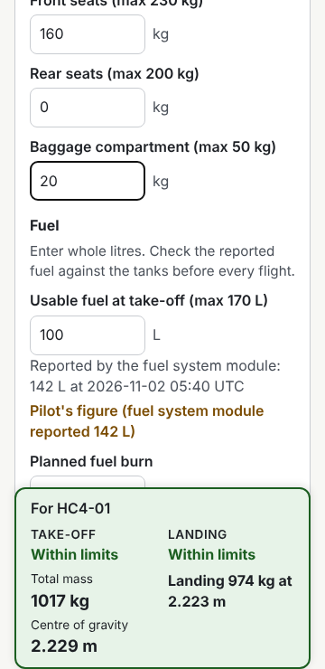

# Weight and Balance

> **Invented aircraft. Not for flight operations.**

[](https://github.com/ThomasBirkmaier/reqseq-weight-and-balance/actions/workflows/ci.yml)

A pilot enters what is on board a small aircraft and sees at once whether its mass and centre of gravity are within the permitted limits. The aircraft (Halcyra HC-4 and HC-2) and all its data are invented; every requirement, decision and piece of evidence is managed with [ReqSeq](https://github.com/ThomasBirkmaier/ReqSeq) in `spec/`.

**Live app:** <https://thomasbirkmaier.github.io/reqseq-weight-and-balance/> (HC-4 fleet) and <https://thomasbirkmaier.github.io/reqseq-weight-and-balance/hc2/> (HC-2 variant).



## Read the chain with ReqSeq

Install ReqSeq 0.7.1 from its [release](https://github.com/ThomasBirkmaier/ReqSeq/releases/tag/v0.7.1), then:

```sh
reqseq trace chain N-e9c5c6 --workspace spec     # a need down to its requirements and test evidence
reqseq trace chain HAZ-5c7c88 --workspace spec   # a hazard to the safety requirements that mitigate it
reqseq evidence status --workspace spec          # verification and validation status of every element
```

## Layout

| Path | Content |
| --- | --- |
| `spec/` | ReqSeq workspace: stakeholders, needs, hazards, decisions (with the aircraft data), glossary, system requirements, evidence |
| `data/fleet.csv` | Fleet data file: empty mass, lever arm and weighing date per aircraft |
| `data/fuel-module.json` | Fuel interface data file of the fuel system module supplier: fuel density, fuel lever arm, usable fuel capacity, reported fuel per aircraft |
| `core/` | Calculation core in Rust, compiled to WebAssembly; acceptance tests per requirement |
| `web/` | Web app in TypeScript with SVG graphics |
| `e2e/` | Playwright end-to-end tests and validation walk-throughs |
| `scripts/` | Build, local server, mapping of Rust test names for ReqSeq, evidence gate |

## Build and test

```sh
cd core && cargo nextest run && cd ..   # core tests
npm ci && npm run build                  # WebAssembly + web app into dist/
npx playwright test                      # end-to-end tests (serves dist/ itself)
```

Static checks (CI job `lint`; every finding is an error):

```sh
npm run lint:core   # rustc, Clippy (all, pedantic, nursery, cargo, selected restriction lints) and rustdoc, host and WebAssembly
npm run typecheck   # TypeScript with every strict flag: web app, e2e tests, service worker, scripts
npm run lint        # ESLint, typescript-eslint strictTypeChecked + stylisticTypeChecked, Playwright rules, zero warnings
shellcheck -o all scripts/*.sh && ruff check scripts && mypy scripts/*.py
```

The settings are in `core/Cargo.toml` (`[lints]`), `core/clippy.toml`, `tsconfig.base.json`, `eslint.config.mjs`, `ruff.toml` and `mypy.ini`; `rust-toolchain.toml` fixes the Rust version, so that a new Clippy cannot fail a build without a change here. An exception is a local `#[expect(..., reason = "...")]` or `eslint-disable-next-line ... -- reason`.

Tests are named after the acceptance criterion they check, by its criterion key (never its number), for example `[SR-3a4905/AK-gt5z] exactly the maximum take-off mass is within limits`; `reqseq element get SR-3a4905` shows the key of each criterion. Rust tests carry the key in the function name (`sr_3a4905_ak_gt5z_...`), which `scripts/junit-map.py` turns into the bracket form. CI (ReqSeq 0.14.0) enriches the JUnit reports with `reqseq evidence enrich-junit`: the core unit tests once per view (`scripts/junit-split-views.py` leaves out the tests of requirements that do not apply in a view), the HC-2 end-to-end suite for the variant VAR-f23826. The job `evidence` fails when an approved requirement has no passed test at its current version in the core or the HC-2 view.

The supplier's requirements live in a private repository and are named here only by ID and version; without it ReqSeq shows them as not accessible. ReqSeq looks for it at `fuel/` inside this repository by default. To use a checkout elsewhere, for example next to this repository, name it in the untracked file `spec/.reqseq/local.yaml`:

```yaml
reqseq-local: 1
repositories:
  fuel: { path: ../../reqseq-weight-and-balance-fuel }
```

## Licence

MIT, see [LICENSE](LICENSE).
