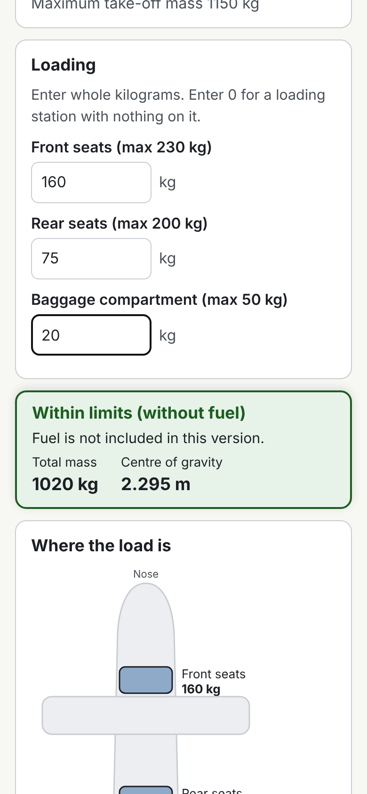

# Weight and Balance

> **Invented aircraft. Not for flight operations.**

[](https://github.com/ThomasBirkmaier/reqseq-weight-and-balance/actions/workflows/ci.yml)

A pilot enters what is on board a small aircraft and sees at once whether its mass and centre of gravity are within the permitted limits. The aircraft (Halcyra HC-4 and HC-2) and all its data are invented; every requirement, decision and piece of evidence is managed with [ReqSeq](https://github.com/ThomasBirkmaier/ReqSeq) in `spec/`.

**Live app:** <https://thomasbirkmaier.github.io/reqseq-weight-and-balance/> (HC-4 fleet) and <https://thomasbirkmaier.github.io/reqseq-weight-and-balance/hc2/> (HC-2 variant).



## Read the chain with ReqSeq

Install ReqSeq 0.7.0 from its [release](https://github.com/ThomasBirkmaier/ReqSeq/releases/tag/v0.7), then:

```sh
reqseq trace chain N-e9c5c6 --workspace spec     # a need down to its requirements and test evidence
reqseq trace chain HAZ-5c7c88 --workspace spec   # a hazard to the safety requirements that mitigate it
reqseq evidence status --workspace spec          # verification and validation status of every element
```

## Layout

| Path | Content |
| --- | --- |
| `spec/` | ReqSeq workspace: stakeholders, needs, hazards, decisions (with the aircraft data), glossary, system requirements, evidence |
| `data/fleet.csv` | Fleet data file: empty mass, lever arm and weighing date per aircraft |
| `core/` | Calculation core in Rust, compiled to WebAssembly; acceptance tests per requirement |
| `web/` | Web app in TypeScript with SVG graphics |
| `e2e/` | Playwright end-to-end tests and validation walk-throughs |
| `scripts/` | Build, local server, mapping of Rust test names for ReqSeq |

## Build and test

```sh
cd core && cargo nextest run && cd ..   # core tests
npm ci && npm run build                  # WebAssembly + web app into dist/
npx playwright test                      # end-to-end tests (serves dist/ itself)
```

Tests are named after the acceptance criterion they check, for example `[SR-3a4905/AK2] exactly the maximum take-off mass is within limits`; CI enriches the JUnit reports with `reqseq evidence enrich-junit`.

## Licence

MIT, see [LICENSE](LICENSE).
